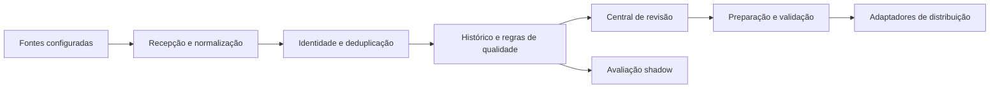
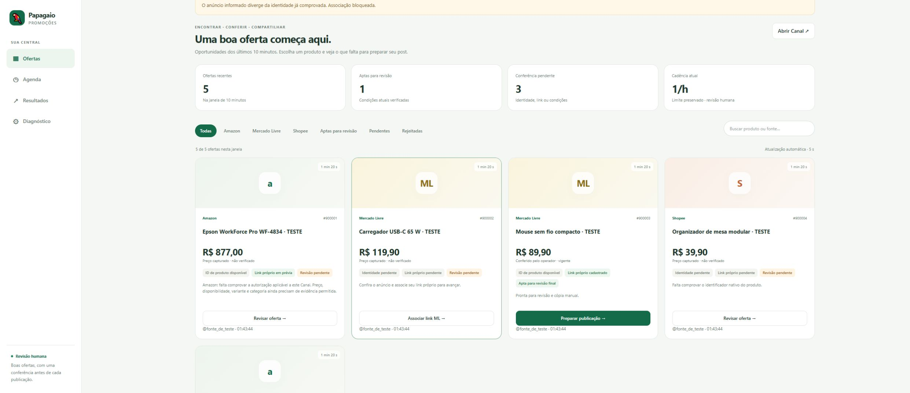
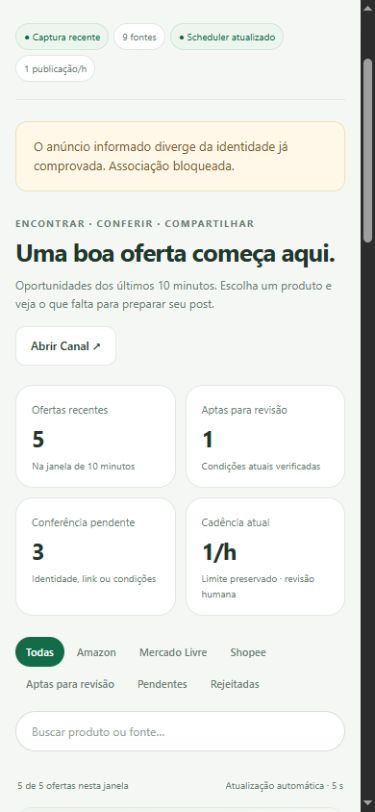

# Papagaio Promoções · PromoBot

**Ofertas organizadas em um fluxo de captura, deduplicação e revisão.**

Ferramenta de automação de curadoria de promoções, construída com apoio de agentes de IA. O projeto conecta recebimento de mensagens, normalização de ofertas, qualidade de dados, rastreabilidade e preparação para distribuição. Este repositório contém documentação pública.

## O problema e a solução

A mesma promoção pode chegar por várias fontes, com textos e links diferentes. Preços, parcelas e condições de cupom podem ser confundidos; uma associação errada pode misturar produtos ou preparar uma publicação incorreta.

O PromoBot transforma mensagens em ofertas estruturadas, identifica duplicatas com múltiplos sinais e mantém o vínculo com a origem. A central Papagaio Promoções organiza a conferência de produto, preço e link antes da preparação do conteúdo.

## O que está implementado

- Monitoramento de canais Telegram configurados, com cliente de recepção separado da publicação.
- Extração e normalização de nome, preço, loja, cupom e links.
- Deduplicação, atribuição da primeira fonte e cálculo de atraso entre ocorrências.
- Resolução de links e identificação de produto quando há evidência suficiente.
- Histórico de preços e classificação por regras explícitas.
- Controles para concorrência de publicação e prevenção de repetição.
- Avaliação de políticas em modo shadow: calcula e registra a decisão sem executar aquela distribuição.
- Central web de revisão e preparação de ofertas, incluindo cópias original e revisada.
- Módulos de integração e preparação para WhatsApp, com verificações e limites próprios.

Existência de um módulo não comprova que ele esteja ativo ou validado em todos os canais. A configuração operacional não foi consultada nesta revisão; não se afirma publicação autônoma multicanal completa.

## Um exemplo de qualidade de dados

Uma condição como “cupom válido para compras até determinado valor” não deve virar preço do produto. O projeto tem regras e regressões para separar limites de elegibilidade, desconto e preço, além de preservar a identidade quando o destino de um link não pode ser comprovado.

O ganho demonstrado é a existência de tratamento explícito e verificável desses casos. Não há percentual medido de redução de erros ou horas economizadas.

## Arquitetura em alto nível

Diagrama conceitual dos componentes. Não indica que todos os adaptadores estejam habilitados; não expõe contas, destinos ou dados de sessão.

## Tecnologias confirmadas

| Camada | Tecnologias identificadas |
|---|---|
| Processamento | Python 3.12+ e asyncio |
| Telegram | Telethon e adaptadores de publicação |
| Persistência | SQLite |
| Interface | HTML, CSS, JavaScript e servidor HTTP local |
| Automação de navegador | Playwright em módulos opcionais |
| Qualidade | pytest e Hypothesis, com mocks e fixtures |

O pipeline principal usa regras determinísticas. Não é apresentado como um agente LLM autônomo ou um modelo de Machine Learning treinado.

## Evidências e resultados

| Evidência | Resultado | Contexto |
|---|---:|---|
| Marco de qualidade de dados | **604 testes aprovados** | Resultado histórico registrado em relatório local |
| Novas regressões no marco | **44 casos offline** | Incluídos nos 604; não devem ser somados novamente |
| Comportamento em identidade insuficiente | Preservação de estado inconclusivo | Regras e regressões; sem taxa global medida |

O relatório de 604 testes não é uma execução atual. A suíte não foi reexecutada para este portfólio. Os resultados demonstram validação de desenvolvimento, sem comprovar alcance, conversão, receita ou comissão. [Evidências e limites](docs/evidencias.md).

## Interface

Captura histórica de fixture: produtos marcados como TESTE, origem fictícia e contadores de demonstração. Os números da tela não são métricas operacionais.

Ver revisão em tela pequena

Captura do mesmo conjunto de demonstração; sem comprovação de publicação externa.

## Desenvolvimento com agentes de IA

Usei principalmente **Codex e Kiro** no desenvolvimento dos meus projetos, com uso pontual de Gemini/Antigravity. Os registros do PromoBot mostram investigação de casos de preço e cupom, mudanças delimitadas e validação offline para preservar o comportamento existente.

IA foi utilizada como apoio à construção. As decisões do pipeline publicado neste estudo de caso são descritas pelas regras implementadas, sem atribuir ao sistema capacidades de um agente generativo que não foram comprovadas. [Decisões e processo](docs/decisoes-e-ia.md).

## Competências demonstradas para AI Builder

Automação de um processo operacional; transformação de conteúdo em dados; tratamento de casos ambíguos; interface de conferência humana; integração com plataformas externas e validação antes da ativação.

O estudo de caso não possui vínculo com o iFood. Código-fonte, mensagens reais, links de afiliado, contas, canais e dados operacionais permanecem privados.
